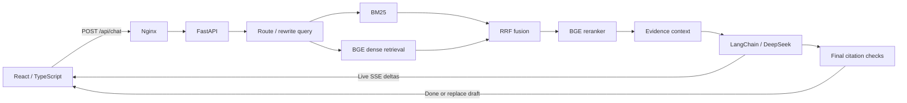

# Intelligent Customer Support Assistant

A document-grounded customer support application built with **FastAPI, LangChain, DeepSeek, React, and TypeScript**. It combines **BM25 + BGE dense retrieval + reciprocal rank fusion + BGE reranking**, then streams cited answers to the browser.

The public repository includes synthetic example documents. Company knowledge bases, internal evaluation data, credentials, model weights, and local execution records are excluded.

## Features

- Markdown/TXT ingestion with normalization, content deduplication, heading-aware chunks, and source metadata.
- A 512-token chunk budget with up to 64 tokens of overlap; Unicode boundaries can shorten overlap.
- BM25 and normalized BGE embeddings, RRF candidate fusion, and BGE reranking for up to five evidence passages.
- LangChain prompts for conversational query rewriting, language-aware search queries, and evidence-grounded generation.
- English interface and answers, with support for Chinese input and Chinese knowledge bases. Original source excerpts retain their original language.
- Real provider text streaming over SSE, progress states, request cancellation, source inspection, and final citation-number checks.
- Insufficient-evidence fallback and human-support contact guidance.
- Docker Compose deployment with an Nginx reverse proxy, health checks, and persistent model/index volumes.

## Quick start

Requires Docker Engine/Desktop running and Docker Compose 2.24 or newer.

```sh
cp .env.example .env
# Optional: set DEEPSEEK_API_KEY in .env using a local editor.
docker compose up -d --build
```

Open [the application](http://localhost:8080), [API documentation](http://localhost:8000/docs), or [health status](http://localhost:8000/api/health).

The default corpus is `data/demo/`. A first full retrieval request downloads the BGE models and can take several minutes. Without a provider key, the application can retrieve and show sources but does not generate answers. For a model-free smoke test, set `RETRIEVAL_MODE=bm25` in `.env` before starting.

Try these questions with the synthetic corpus:

- How do I reset my password?
- How many records can one report export contain?
- Talk to a human agent

To stop the services while preserving cached models:

```sh
docker compose down
```

## Architecture



See [architecture and streaming](docs/architecture.md) for the request lifecycle and [development and deployment](docs/development.md) for configuration, local execution, and adding documents.

## Repository structure

```text
.
├── backend/
│   ├── app/                   # API, ingestion, retrieval, orchestration, evaluation
│   ├── tests/                 # API, retrieval, ingestion, streaming and cancellation
│   ├── Dockerfile
│   └── pyproject.toml
├── frontend/
│   ├── src/                   # React interface and SSE reader
│   ├── tests/                 # SSE parsing and cleanup tests
│   ├── Dockerfile
│   └── nginx.conf
├── data/demo/                 # Synthetic, shareable example documents
├── evaluation/                # Synthetic smoke questions and metric definitions
├── docs/                      # Architecture, setup and verification notes
├── scripts/                   # Live provider verification and clean source packaging
├── .github/workflows/         # Backend/frontend checks
├── .env.example               # Empty provider-key example
└── compose.yaml
```

## Tests

Python 3.11+ and Node.js 22+ are required for local development; local checks used Python 3.12.

```sh
python3 -m venv .venv
.venv/bin/pip install -e './backend[test]'
(cd backend && ../.venv/bin/python -m pytest -q)
(cd frontend && npm ci && npm test && npm run build)
```

The backend tests and frontend build do not require a provider key or BGE model downloads. The first ingestion/tokenizer use can download tokenizer data. Model-based retrieval checks additionally require `.[models]`.

See [verification notes](docs/verification.md) for actual local checks and their limits. The included [synthetic evaluation examples](evaluation/README.md) exercise the evaluator; they do not establish production accuracy, latency, or cost.

## API

`POST /api/chat` accepts a question and optional bounded conversation history:

```json
{"question":"How do I reset my password?","history":[]}
```

SSE events are `status`, `sources`, `token`, `replace`, `done`, and `error`. Clients append `token` text, overwrite the draft on `replace`, and treat a response as complete only after `done`.

